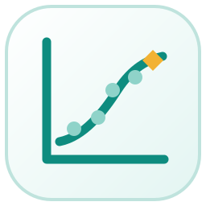
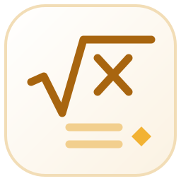

<picture><source media="(prefers-color-scheme: dark)" srcset="site/public/mark-light.svg"></picture>

# Edgar Mendonca

Engineer, researcher and software developer. I build engineering software, deliver rotating-equipment packages for oil and gas, and study how materials behave under impact and load.

**Portfolio:** [edgar-mendonca.github.io/Edgar-Mendonca](https://edgar-mendonca.github.io/Edgar-Mendonca/) · 

## Software

### Datum

<a href="https://edgar-mendonca.github.io/Datum/"><picture><source media="(prefers-color-scheme: dark)" srcset="site/public/icons/datum-logo-light.svg"></picture></a>

Free, open-source desktop apps for engineers and scientists, written from scratch in Rust.

| | App | What it does |
| :-: | --- | --- |
|  | [Datum Plan](https://github.com/Edgar-Mendonca/Datum-Plan) | Plan, schedule, track and report projects |
|  | [Datum Plot](https://github.com/Edgar-Mendonca/Datum-Plot) | Analyse data and make publication-ready graphs |
|  | [Datum Atlas](https://github.com/Edgar-Mendonca/Datum-Atlas) | Choose materials with property charts and selection indices |
|  | [Datum Sim](https://github.com/Edgar-Mendonca/Datum-Sim) | Model and simulate dynamic systems |
|  | [Datum Calc](https://github.com/Edgar-Mendonca/Datum-Calc) | Engineering calculations with real units and checks |
|  | [Datum Mesh](https://github.com/Edgar-Mendonca/Datum-Mesh) | Finite-element analysis of parts and frames |
|  | [Datum Pipe](https://github.com/Edgar-Mendonca/Datum-Pipe) | Pipe stress analysis with an automatic isometric |
|  | [Datum Schema](https://github.com/Edgar-Mendonca/Datum-Schema) | Intelligent P&IDs and process flow diagrams |
|  | [Datum Layout](https://github.com/Edgar-Mendonca/Datum-Layout) | 3D plant layout and piping |

### Other software

| | App | What it does |
| :-: | --- | --- |
|  | [CentriForge](https://github.com/Edgar-Mendonca/Compressor-Engineering-Suite) | Compressor engineering suite for centrifugal compressors (API 617 scope) |
|  | [SHPB Analysis](https://github.com/Edgar-Mendonca/SHPB-Analysis) | Stress–strain curves from Split Hopkinson Pressure Bar signals |

## Research

- [Split Hopkinson Pressure Bar: design, testing and data analysis](https://edgar-mendonca.github.io/Edgar-Mendonca/research/shpb)
- [Stress waves in solids](https://edgar-mendonca.github.io/Edgar-Mendonca/research/stress-waves)
- [Lateral compression of thin-walled tubes](https://edgar-mendonca.github.io/Edgar-Mendonca/research/lateral-compression)

---

This repository also holds the portfolio site (`site/`, Astro: `cd site && npm ci && npm run build`) and the [brain](brain/README.md), a neural network in Python trained on my work.
